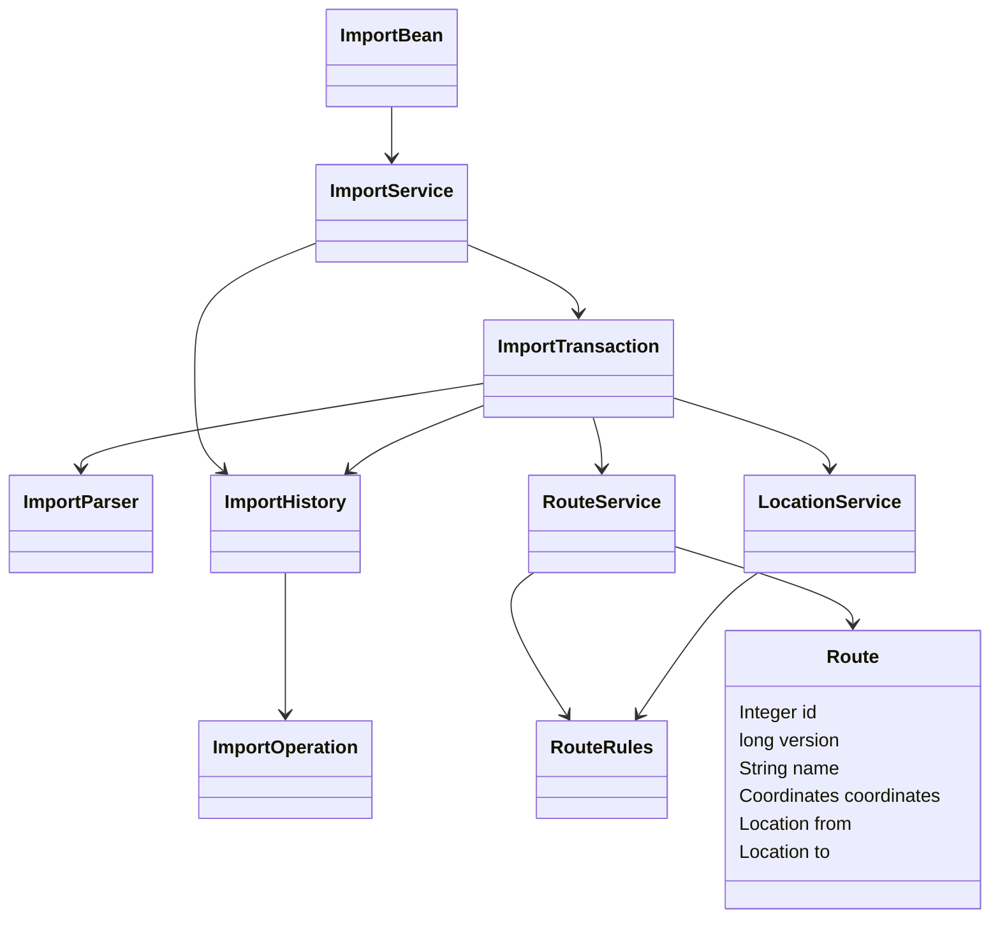
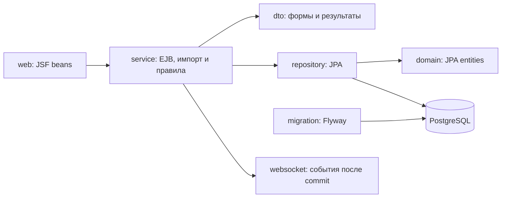

# ЛР2, вариант 548

Доработка ЛР1 (Route, вариант 12014). С пользователем согласованы JSON и два новых правила:
имя маршрута уникально без учёта регистра/крайних пробелов; пара `coordinates.x, coordinates.y` уникальна.
Эти правила реализованы только в Java: новых UNIQUE-ограничений, индексов уникальности и триггеров нет.
Формат и ограничения остаётся представить преподавателю согласно заданию.

## Что добавлено

| Требование | Реализация |
|---|---|
| Загрузка файла через веб-интерфейс | JSF `import.xhtml`, multipart `Part` |
| Вложенные объекты в одной записи | `coordinates`, `from`, необязательный `to` внутри JSON-объекта маршрута |
| Проверка ввода | `ImportParser`: обязательность, типы, int/long/float/double, конечность чисел, ограничения ЛР1, номер записи |
| Атомарность | Пакет маршрутов и новых локаций в одной EJB/JTA-транзакции |
| История успеха и ошибки | `import_operations`, RUNNING/SUCCESS/FAILED; число объектов только при SUCCESS |
| Своя/общая история | Principal контейнера, роли user/admin, ограничение запроса в `ImportHistory` |
| Уникальность при конкуренции | Общий transaction advisory lock и проверки в `RouteRules` |
| Изменение устаревшего объекта | `@Version`, версия в DTO/форме и проверка перед update/delete |
| Многопользовательская проверка | JMeter: два независимых клиента, barrier перед конфликтующей записью |

Новых runtime-библиотек нет. JSON-P, Bean Validation, безопасность, EJB и JTA предоставляет WildFly.
Parsson добавлен только для unit-тестов.

## Формат импорта

UTF-8 JSON-массив из 1–1000 записей, максимум 1 МиБ. Неизвестные поля отклоняются.
`id`, `creationDate`, `version` назначает сервер, передавать их нельзя.

```json
[
  {
    "name": "До библиотеки",
    "coordinates": {"x": 123.5, "y": 777},
    "from": {"x": 1, "y": 2.5, "z": 3, "name": "Начало"},
    "to": null,
    "distance": 4.5,
    "rating": 8
  }
]
```

Все показанные поля обязательны, кроме `to` и `name` внутри локации. `to` можно пропустить или задать null.
У маршрута название непустое, не длиннее 255 символов (существующий размер колонки ЛР1),
расстояние строго больше 1, рейтинг — положительный int.
`coordinates.y` — long, `location.x` — int; дробные значения для них не округляются.
У локаций `x/y/z` обязательны; `name` может быть null, максимум 755 символов.
Каждая вложенная локация создаётся заново; выбор существующей локации остаётся в обычной форме ЛР1.
Дубли внутри одного файла тоже откатывают весь импорт.
Примеры: [успешный](examples/routes.json), [ошибка во второй записи](examples/rollback.json).

## Транзакции и конфликты

`ImportService` работает с NOT_SUPPORTED. `ImportHistory.start()` отдельной REQUIRES_NEW-транзакцией
создаёт RUNNING. Затем `ImportTransaction.execute()` открывает REQUIRES_NEW для всего пакета.
Сервисы локаций, маршрутов и `history.succeed()` присоединяются к ней через REQUIRED.
В одном commit появляются все объекты и SUCCESS. Исключение откатывает и маршруты, и вложенные локации;
только после возврата из откатившегося EJB `history.fail()` отдельной REQUIRES_NEW сохраняет FAILED.
Ошибки JSON также остаются в истории. При аварийном завершении процесса возможен RUNNING:
автоматическое восстановление незавершённых задач в эту лабораторную не добавлялось.

На RouteDS явно установлен READ COMMITTED. Самого этого уровня недостаточно для схемы
«проверить отсутствие имени → вставить»: две транзакции могут одновременно увидеть отсутствие строки.
Перед каждой записью приложение берёт `pg_advisory_xact_lock(12014548)`, затем проверяет уникальность.
Lock общий для create/update/delete, спецопераций, импорта и изменения локаций. Он освобождается при commit/rollback.
Следующий запрос после ожидания lock на READ COMMITTED видит commit предыдущего писателя.
Чтения этот lock не берут.

Поэтому повышать уровень до SERIALIZABLE для этих операций не требуется: необходимую сериализацию
писателей обеспечивает общий lock, а свежесть пользовательской формы — версия.
Просто заменить уровень на REPEATABLE READ опасно: снимок до ожидания lock может остаться устаревшим.
Поведение снимков описано в [PostgreSQL 17: Transaction Isolation](https://www.postgresql.org/docs/17/transaction-iso.html),
жизненный цикл advisory lock — в [PostgreSQL 17: Explicit Locking](https://www.postgresql.org/docs/17/explicit-locking.html#ADVISORY-LOCKS).

`Route.version` увеличивается Hibernate при редактировании. Форма хранит прочитанную версию;
под lock сервис проверяет её перед сохранением или удалением. Две старые формы не могут молча
перезаписать друг друга: одна проходит, другая получает понятную ошибку. При удалении первым
пользователем второй получает «Маршрут уже удалён». SQL-перепривязка локаций тоже увеличивает версии маршрутов.

Цена простоты — записи выполняются последовательно, длительный импорт задерживает другие записи.
Для учебной ИС это осознанный компромисс. Прямой SQL в обход сервисов не поддерживает новые правила уникальности,
что соответствует требованию реализовать их на программном уровне. Ранее существовавшие данные не переписываются:
если в рабочей БД уже есть дубли, их нужно исправить обычным редактированием/удалением.

## Разбиение на двух участников

Каждая строка — маленькая задача с отдельным проверяемым результатом. Коммиты объединяют связанные задачи,
чтобы промежуточные изменения можно было собрать. Точный состав файлов — в [COMMITS.md](COMMITS.md).

| ID | Участник | Задача | Критерий готовности |
|---|---|---|---|
| A1 | 1: импорт | Описать JSON-запись | Вложенные поля на одном уровне записи маршрута |
| A2 | 1 | Сделать успешный пример | Пример принимается парсером |
| A3 | 1 | Сделать пример ошибки | Видно, какая запись некорректна |
| A4 | 1 | Разобрать массив и вложенные объекты | Обязательные поля не подменяются значениями по умолчанию |
| A5 | 1 | Проверить типы и границы чисел | Нет тихого округления long/int или infinity |
| A6 | 1 | Ограничить размер/число записей | Ошибка на файле >1 МиБ и >1000 записей |
| A7 | 1 | Покрыть парсер тестами | Невалидный JSON и доменные ошибки отклоняются |
| A8 | 1 | Добавить entity и V4 | История хранится после перезапуска |
| A9 | 1 | Начинать историю отдельным commit | RUNNING существует до обработки файла |
| A10 | 1 | Ограничить выборку истории | user — свои строки; admin — все |
| A11 | 1 | Проверить владельца при завершении | Чужую операцию завершить нельзя |
| A12 | 1 | Сохранить пакет одной транзакцией | Ошибка второй записи отменяет первую и её локации |
| A13 | 1 | Сохранить SUCCESS вместе с данными | Статус и объекты фиксируются вместе |
| A14 | 1 | Сохранить FAILED после rollback | Число добавленных объектов пустое |
| A15 | 1 | Добавить загрузку и таблицу истории | Файл загружается с браузера, видны ошибки |
| A16 | 1 | Настроить пользователей/роли и multipart | Автор берётся из контейнера, файл достигает сервера |
| B1 | 2: конкуренция | Добавить версию маршрута и V5 | Hibernate видит version; старые миграции не изменены |
| B2 | 2 | Передать версию через DTO и форму | Сохраняется версия открытого редактора |
| B3 | 2 | Проверить версию при update/delete | Устаревшая форма получает конфликт |
| B4 | 2 | Проверить уникальность имени | Регистр и крайние пробелы не обходят правило |
| B5 | 2 | Проверить уникальность координат | Второй маршрут с такой же парой отклоняется |
| B6 | 2 | Охватить все пути записи одним lock | CRUD, функции БД и импорт используют общие правила |
| B7 | 2 | Учесть SQL-перепривязку локаций | Изменённый через SQL маршрут получает новую версию |
| B8 | 2 | Показать новые ошибки в старых формах | Ошибки видны в списке, карточке и спецоперациях |
| B9 | 2 | Настроить два JMeter-клиента и барьер | У каждого свои cookie/credentials, записи стартуют вместе |
| B10 | 2 | Проверить обычный CRUD | Созданный маршрут изменяется и удаляется |
| B11 | 2 | Проверить обе гонки уникальности | В каждой гонке ровно один успех |
| B12 | 2 | Проверить update/update, delete/delete, update/delete | Одна операция проходит, другая получает конфликт |
| B13 | 2 | Проверить import/import и import/create | Дубль не появляется между разными путями записи |
| B14 | 2 | Проверить откат вложенных объектов | Количество локаций после ошибки не выросло |
| B15 | 2 | Проверить роли истории | Оба обычных пользователя видят только своё |
| B16 | 2 | Обосновать изоляцию и описать результат | Документация соответствует проверенному поведению |

## Запуск проверок

```sh
mvn verify
docker compose up --build -d
jmeter -n -t docs/jmeter/lab2.jmx -l /tmp/lab2.jtl -j /tmp/lab2-jmeter.log
```

JMeter 5.6.3 запускается под Java 17 из корня репозитория, адрес задаётся `-JbaseUrl=http://localhost:8080/routes`.
План использует два потока и отдельные HTTP-клиенты, а сценарий написан на Groovy JSR223.
Он обращается к настоящим JSF-формам с cookie и ViewState; отдельный API только ради тестов не добавлен.
Barrier имеет timeout, поэтому падение одного потока не вызывает вечного ожидания второго.
Не меняйте число потоков без изменения барьера. Параметры и CLI описаны в
[официальной документации JMeter](https://jmeter.apache.org/usermanual/get-started.html#non_gui).

Результат JMeter нужно оценивать по `success` в JTL и итоговому `Err: 0`, а не только по exit code.
Ожидаемые бизнес-конфликты считаются успешной проверкой, если проигравший запрос вернул нужную ошибку.
План добавляет строки `JM-<timestamp>-...` и историю, оставляя их для осмотра после прогона.
Не используйте этот сценарий против базы с важными данными; отдельный compose project создаёт свой volume.

Фактические результаты прогонов приведены в [VALIDATION.md](VALIDATION.md).

## Диаграммы для отчёта




